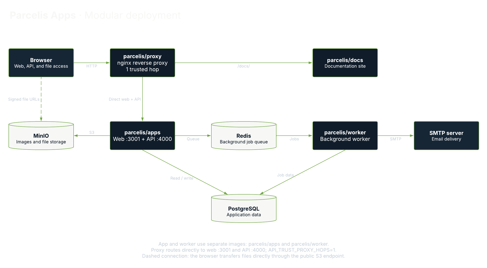

  

#### Parcelis (PAR-suhl-iss) is an open-source property management platform for landlords, small operators, and local property teams.

# Parcelis Apps

`parcelis/apps` packages the Parcelis web application and API in one image,
providing the interface and application services for managing properties,
leases, and tenants.

In the modular Compose stack, it sits behind `parcelis/proxy`, connects to
PostgreSQL, Redis, and S3-compatible storage, and runs alongside the separate
`parcelis/worker` and `parcelis/docs` images.

## Deployment Architecture

[View the diagram in Lucid](https://lucid.app/lucidchart/844aa831-3d40-4c01-8708-bad13ac883e3/view).

Use the [modular Compose stack](../../../docker-compose.yml) and its [environment template](../../../.env.production.example). The application images `parcelis/apps`, `parcelis/proxy`, `parcelis/docs`, and `parcelis/worker` use `latest` tags. For a specific release, replace only these application image tags with that release tag. Keep `parcelis/minio:final` and `parcelis/minio-init:final` unchanged.

See the [deployment documentation](https://docs.parcelis.dev/) for setup and upgrades.
