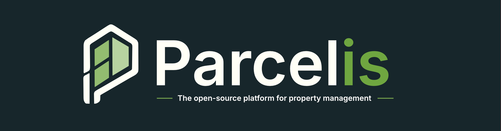

  

#### Parcelis (PAR-suhl-iss) is an open-source property management platform for landlords, small operators, and local property teams.

# Parcelis Docs

`parcelis/docs` packages the bundled Parcelis documentation site and serves its
static pages through nginx.

In the modular Compose stack, it runs alongside `parcelis/apps` and receives
requests at `/docs/` through `parcelis/proxy`.

## Deployment Architecture

[View the diagram in Lucid](https://lucid.app/lucidchart/844aa831-3d40-4c01-8708-bad13ac883e3/view).

Use the [modular Compose stack](https://github.com/parcelis/parcelis/blob/main/docker-compose.yml) and its [environment template](https://github.com/parcelis/parcelis/blob/main/.env.production.example). Choose a matching release tag for all Parcelis images in the stack.

Maintained guides and API reference are available at [docs.parcelis.dev](https://docs.parcelis.dev/).
