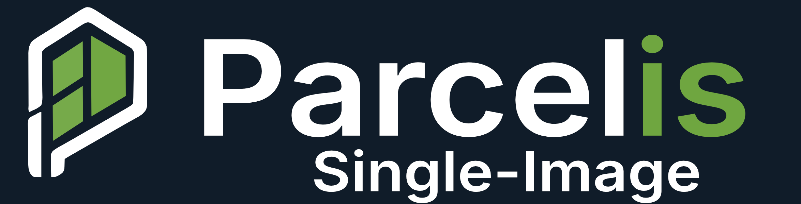
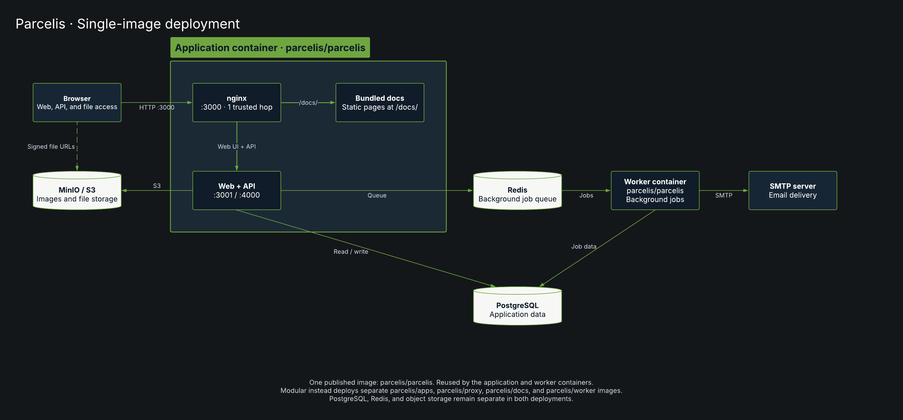

  

#### Parcelis (PAR-suhl-iss) is an open-source property management platform for landlords, small operators, and local property teams.

# Parcelis Single Image

`parcelis/parcelis` packages the Parcelis web application, API,
nginx routing, and worker runtime in one image for the single-image deployment.
It provides the interface and application services for managing properties,
leases, and tenants through one exposed application port.

The application and worker run in separate containers using this same image.
It connects to PostgreSQL, Redis, and S3-compatible storage as external services.

### Deployment Architecture

[View the diagram in Lucid](https://lucid.app/lucidchart/68fb062e-a8ed-4cc1-ba55-3740d605434d/view).

Use the [single-image Compose stack](../../../docker-compose-single-image.yml)
and its [environment template](../../../.env.production.example).
This Compose example uses `parcelis/parcelis:latest` for the application, worker, and migration job.

See the [deployment documentation](https://docs.parcelis.dev/) for setup and upgrades.
