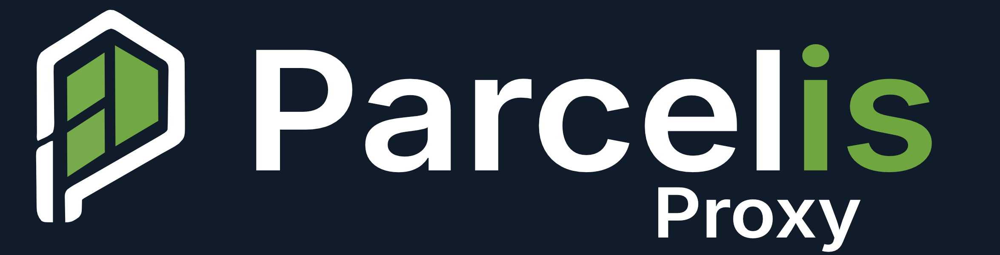
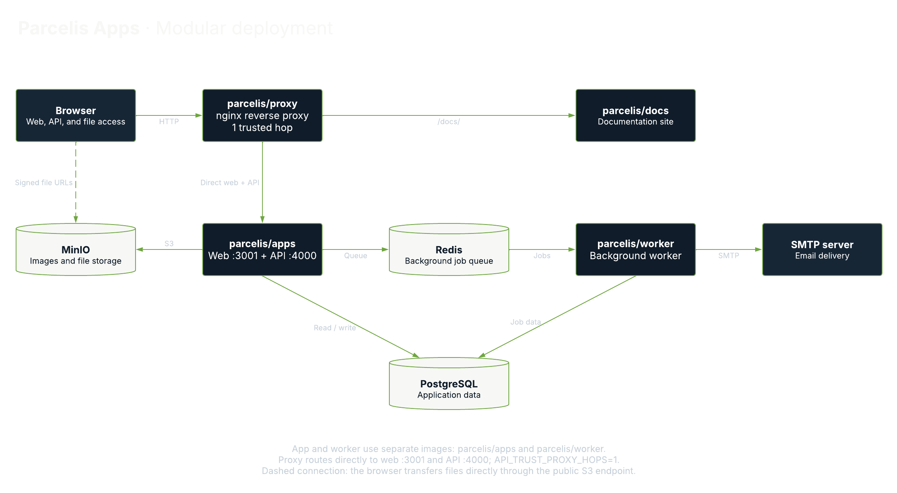

  

#### Parcelis (PAR-suhl-iss) is an open-source property management platform for landlords, small operators, and local property teams.

# Parcelis Proxy

`parcelis/proxy` provides the nginx reverse proxy for the modular Parcelis
deployment, giving browser requests a single entry point for the web application,
and API.

It routes requests directly to `parcelis/apps` on the
container network. The connection to the API passes through one trusted proxy
hop.

## Deployment Architecture

[View the diagram in Lucid](https://lucid.app/lucidchart/844aa831-3d40-4c01-8708-bad13ac883e3/view).

Use the [modular Compose stack](../../../docker-compose.yml) and its [environment template](../../../.env.production.example). The application images `parcelis/apps`, `parcelis/proxy`, and `parcelis/worker` require `PARCELIS_VERSION` to select a release or local build that includes the documentation removal. Keep `parcelis/minio:final` and `parcelis/minio-init:final` unchanged.

See the [deployment documentation](https://docs.parcelis.dev/) for setup and TLS configuration.
