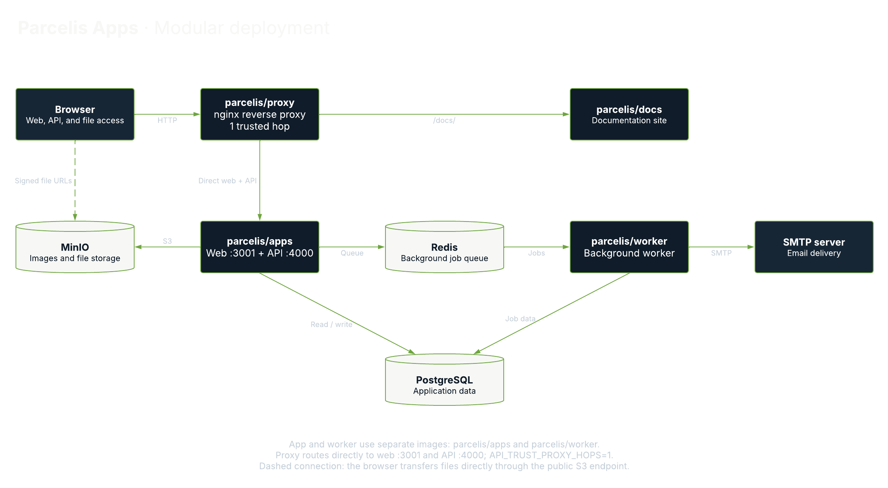

  

#### Parcelis (PAR-suhl-iss) is an open-source property management platform for landlords, small operators, and local property teams.

# Parcelis Worker

`parcelis/worker` runs Parcelis background jobs, including email notifications
and scheduled lease activation and expiration. It dispatches saved application
events, processes queued jobs, and retries temporary failures.

In the modular Compose stack, it runs separately from `parcelis/apps` and
connects to PostgreSQL, Redis, and the configured SMTP server.

## Deployment Architecture

[View the diagram in Lucid](https://lucid.app/lucidchart/844aa831-3d40-4c01-8708-bad13ac883e3/view).

Use the [modular Compose stack](../../../docker-compose.yml) and its [environment template](../../../.env.production.example). The application images `parcelis/apps`, `parcelis/proxy`, `parcelis/docs`, and `parcelis/worker` use `latest` tags. For a specific release, replace only these application image tags with that release tag. Keep `parcelis/minio:final` and `parcelis/minio-init:final` unchanged.

See the [deployment documentation](https://docs.parcelis.dev/) for setup and upgrades.
